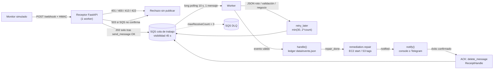

# Fénix — autorreparación de infraestructura sobre LocalStack

## 1. Objetivo del sistema

Fénix es un sistema didáctico de **autorreparación de infraestructura** que demuestra, de punta a punta, el circuito:

**webhook autenticado → cola SQS → worker → reparación por API → aviso externo → ACK**.

Un monitor simulado envía alertas firmadas a un receptor HTTP. El receptor **no repara dentro de la petición**: autentica la firma HMAC, valida el contrato, guarda la orden en SQS y recién entonces responde `202`. Un worker independiente consume la cola, revalida el evento contra el inventario del grupo, ejecuta una reparación **convergente** y verifica el estado final por API:

- **`node-01`** (`instance.stopped`): una instancia EC2 mock detenida vuelve a `running`.
- **`bucket-01`** (`bucket.tags_missing`): un bucket S3 recupera las etiquetas obligatorias, preservando las ajenas a la política.

El sistema implementa entrega **al menos una vez**, backoff por visibilidad, DLQ con `RedrivePolicy`, registro durable por etapas (`data/events.json`), logs JSON correlacionados con rotación gzip y notificaciones reales por Telegram (modo `console` para desarrollo).

Qué demuestra:

- Uso de SDK Boto3 contra LocalStack (EC2 mock, S3 y SQS), sin AWS real.
- Validación cerrada de entradas y propiedad de recursos (solo aliases inventariados).
- Idempotencia y reparación convergente ante reintentos, duplicados y reinicios.
- ACK únicamente después de reparar **y** notificar.
- Observabilidad con contexto público y sin secretos.

---

## 2. Integrantes y roles

| Rol | Apellido y nombre | Correo | Tareas y módulos | Pruebas defendidas / responsabilidad |
| --- | --- | --- | --- | --- |
| I1 — Contratos, seguridad de entrada y webhook | Hernan Lamadrid | <!-- COMPLETAR --> | `utils/errors.py`, `utils/validation.py`, `services/events.py`, `utils/crypto.py`, `services/receiver.py` | F02–F07 |
| I2 — Mensajería e inventario cloud | Gabriel Avellaneda | <!-- COMPLETAR --> | `services/sqs.py`, configuración en `config/settings.py`, creación del laboratorio en `services/demo.py` | F01, F08, F10 |
| I3 — Reparación, worker e integración | Maximiliano Ríos | <!-- COMPLETAR --> | `remediation.repair`, `remediation.handle`, `services/worker.py`, `services/notifications.py`, `utils/logging_json.py`, `cli.py` | F09, F11–F16 |
| I4 — Pruebas y diagnóstico | Lorenzo Lamas | <!-- COMPLETAR --> | `tests/test_scenarios.py`, diagnóstico de fallos y resultados, evidencias de ejecución, inyección controlada de fallas (`demo.inject_fault`) | Ejecución integral y diagnóstico de F01–F16, con apoyo de los responsables de cada módulo |

---

## 3. Prerrequisitos y versiones

| Componente | Versión / requisito | Verificación |
| --- | --- | --- |
| Sistema operativo | GNU/Linux (probado en Debian 13), macOS/WSL o Windows 11 | `python --version` |
| Python | 3.11 o superior (`pyproject.toml`: `requires-python = ">=3.11"`) | `python --version` o `py -3.11 --version` |
| Docker Engine | Con Compose v2 (`docker compose`, no `docker-compose`) | `docker compose version` |
| LocalStack | Imagen definida en `.env` (`LOCALSTACK_IMAGE`) | `http://localhost:4566/_localstack/health` |
| Git | Necesario para clonar el repositorio | `git --version` |

Las dependencias Python se instalan desde `pyproject.toml`, que toma la lista de `requirements.txt`. `requirements-lock.txt` es una instantánea de versiones; actualizarlo solo cuando se renueven las dependencias.

El emulador se levanta con EC2 en modo **mock** (`EC2_VM_MANAGER=mock`); no se ejecuta una VM real. LocalStack puede requerir `LOCALSTACK_AUTH_TOKEN` según el plan/imagen de la cátedra: si la imagen elegida lo exige, completarlo en `.env`.

---

## 4. Instalación

Elegí la guía de tu sistema operativo. Los comandos de preparación se ejecutan una sola vez desde la raíz del repositorio; el inicio del laboratorio y el ejemplo completo están en la sección 8.

### 4.1 Linux o macOS (Bash)

1. Instalar Python 3.11 o superior, Git y Docker con Compose v2.
2. Clonar el repositorio (reemplazar la URL por la dirección real):

   ```bash
   git clone "URL_DEL_REPOSITORIO" fenixG10
   cd fenixG10
   ```

3. Crear y activar el entorno virtual, e instalar el proyecto:

   ```bash
   python3 -m venv .venv
   source .venv/bin/activate
   python -m pip install --upgrade pip
   python -m pip install -e .
   ```

4. Crear `.env` solo si aún no existe y generar el secreto:

   ```bash
   test -f .env || cp .env.example .env
   python -c "import secrets; print(secrets.token_urlsafe(32))"
   ```

   Pegar el valor generado en `WEBHOOK_SECRET=` y completar las demás variables de la sección 5. Para el flujo completo, hacen falta el token de Telegram, el `TELEGRAM_CHAT_ID` y el token de LocalStack entregado para la cátedra. No usar credenciales reales de AWS.

### 4.2 Windows 11 (PowerShell desde Visual Studio o VS Code)

1. Abrir una terminal PowerShell. Instalar Python 3.11, Git y Docker Desktop con `winget`:

   ```powershell
   winget install --id Python.Python.3.11 --exact
   winget install --id Git.Git --exact
   winget install --id Docker.DockerDesktop --exact
   ```

   Si `winget` no está disponible, instalar las herramientas desde Microsoft Store o sus sitios oficiales. Si se solicita, reiniciar Windows. Docker Desktop requiere WSL 2 y contenedores Linux; iniciar Docker Desktop y completar su configuración inicial.

2. Comprobar WSL:

   ```powershell
   wsl --status
   ```

   Si WSL aún no está instalado, ejecutar PowerShell como administrador:

   ```powershell
   wsl --install
   ```

   Reiniciar Windows si lo solicita y luego actualizar WSL:

   ```powershell
   wsl --update
   ```

3. Cerrar y volver a abrir la terminal para actualizar el `PATH`. Comprobar las herramientas:

   ```powershell
   py -3.11 --version
   git --version
   docker compose version
   docker info --format '{{.OSType}}'
   ```

   Docker debe informar `linux` como tipo de contenedor. Si algún comando no se reconoce, finalizar la instalación y abrir una terminal nueva.

4. Clonar el repositorio (reemplazar la URL por la dirección real). Si ya se abrió la carpeta del proyecto en el IDE, pasar al paso 5:

   ```powershell
   New-Item -ItemType Directory -Force "$HOME\source" | Out-Null
   Set-Location "$HOME\source"
   git clone "URL_DEL_REPOSITORIO" fenixG10
   Set-Location .\fenixG10
   ```

5. Crear y activar el entorno virtual:

   ```powershell
   py -3.11 -m venv .venv
   .\.venv\Scripts\Activate.ps1
   ```

   Si PowerShell bloquea la activación, permitir scripts solo en la terminal actual y volver a activar:

   ```powershell
   Set-ExecutionPolicy -Scope Process -ExecutionPolicy Bypass
   .\.venv\Scripts\Activate.ps1
   ```

6. Instalar el proyecto y preparar `.env`:

   ```powershell
   python -m pip install --upgrade pip
   python -m pip install -e .
   if (-not (Test-Path .env)) { Copy-Item .env.example .env }
   python -c "import secrets; print(secrets.token_urlsafe(32))"
   notepad .env
   ```

   Copiar el secreto generado en `WEBHOOK_SECRET=`, completar las demás variables de la sección 5 y guardar el archivo. Para el flujo completo, hacen falta el token de Telegram, el `TELEGRAM_CHAT_ID` y el token de LocalStack entregado para la cátedra. No usar credenciales reales de AWS.

### 4.3 Verificar la instalación

Con el entorno virtual activado, ejecutar las pruebas unitarias:

```text
python -m pytest -v -m "not integracion"
```

Las pruebas de integración requieren que LocalStack y los recursos del laboratorio estén preparados; los pasos están en la sección 8.

---

## 5. Variables de entorno

El archivo `.env` no se versiona. `.env.example` contiene valores ficticios para el emulador; **no usar credenciales de AWS real**.

| Variable | Propósito | Ejemplo (ficticio) |
| --- | --- | --- |
| `AWS_ENDPOINT_URL` | Endpoint del emulador; `settings.py` exige loopback en el puerto 4566 | `http://localhost:4566` |
| `AWS_ACCESS_KEY_ID` | Credencial ficticia para Boto3/LocalStack | `test` |
| `AWS_SECRET_ACCESS_KEY` | Credencial ficticia para Boto3/LocalStack | `test` |
| `AWS_DEFAULT_REGION` | Región usada por los clientes | `us-east-1` |
| `GROUP_ID` | ID del grupo; nombra recursos y etiquetas (`[a-z0-9-]{3,32}`) | `grupo01` |
| `QUEUE_PREFIX` | Prefijo de las colas: `<prefijo>-events` y `<prefijo>-dlq` | `fenix-grupo01` |
| `PROJECT` | Nombre de proyecto (informativo) | `fenix` |
| `WEBHOOK_SECRET` | Secreto HMAC del webhook (mínimo 16 caracteres; **nunca** versionarlo) | `<generado con secrets.token_urlsafe(32)>` |
| `NOTIFY_PROVIDER` | Proveedor de avisos: `console` (desarrollo) o `telegram` (flujo probado) | `telegram` |
| `TELEGRAM_BOT_TOKEN` | Token entregado por `@BotFather`; mantenerlo privado | `<token del bot>` |
| `TELEGRAM_CHAT_ID` | ID de chat obtenido con `getUpdates` (ver sección 13) | `<chat_id>` |
| `SLACK_WEBHOOK_URL` | Slack no está implementado; dejar vacío | *(vacío)* |
| `LOCALSTACK_AUTH_TOKEN` | Token de la cuenta LocalStack entregado para la cátedra | `<token de LocalStack>` |
| `LOCALSTACK_IMAGE` | Imagen de LocalStack usada por `compose.yaml` | `localstack/localstack:2026.10.0` |

> La CLI y uvicorn (`--env-file .env`) cargan `.env` automáticamente. En un script Python independiente, cargarlo con `from dotenv import load_dotenv; load_dotenv()`. No compartir ni versionar `.env`.

---

## 6. Diagrama de arquitectura



Notas:

- La cola en memoria de `logging_json` es solo para observabilidad; **no reemplaza a SQS**.
- El ACK se ejecuta con el `ReceiptHandle` de la recepción actual, nunca con el `MessageId`.
- La DLQ se configura con `RedrivePolicy` y `maxReceiveCount=3`.

---

## 7. Contratos de entrada/salida

### 7.1 Evento de entrada (contrato cerrado)

Todos los campos son obligatorios y no se admiten claves extra. El siguiente JSON ilustra la estructura; para enviarlo hay que actualizar `occurred_at` e `event_id` (ver ejemplo ejecutable en la sección 8):

```json
{
  "schema_version": 1,
  "event_id": "evt-node-001",
  "event_type": "instance.stopped",
  "resource_id": "node-01",
  "occurred_at": "AAAA-MM-DDTHH:MM:SSZ",
  "simulate_failures": 0
}
```

| Campo | Regla |
| --- | --- |
| `schema_version` | Entero exactamente `1`; `true`/`false` no son válidos |
| `event_id` | Texto `[a-z0-9-]{3,32}`; identifica la operación de negocio |
| `event_type` | `instance.stopped` (EC2) o `bucket.tags_missing` (S3) |
| `resource_id` | Alias inventariado (`node-01` o `bucket-01`), nunca un ID/ARN libre |
| `occurred_at` | ISO 8601 con UTC explícito (`Z` o `+00:00`) |
| `simulate_failures` | Entero `0..5` (nunca `bool`); fallas simuladas antes de reparar |

Firma HTTP:

```
X-Webhook-Signature: t=<epoch>,v1=<64 hex>
HMAC-SHA256(secret, bytes(timestamp) + b"." + raw_body)
```

Se rechazan claves duplicadas, formatos ambiguos y timestamps con más de 300 s de diferencia (pasado o futuro).

### 7.2 Inventario (`data/inventory.json`)

Lo genera `setup-demo`; los IDs son los devueltos por el emulador. Estructura real:

```json
{
  "node-01": {
    "type": "ec2",
    "id": "i-0123456789abcdef0",
    "security_group_id": "sg-0123456789abcdef0",
    "expected_tags": {
      "ManagedBy": "ppa2",
      "Project": "fenix",
      "GroupId": "<GROUP_ID>",
      "Owner": "<GROUP_ID>"
    }
  },
  "bucket-01": {
    "type": "s3",
    "id": "fenix-<GROUP_ID>-bucket-01",
    "expected_tags": {
      "ManagedBy": "ppa2",
      "Project": "fenix",
      "GroupId": "<GROUP_ID>",
      "Owner": "<GROUP_ID>"
    }
  }
}
```

El receptor y el worker **solo** resuelven aliases presentes en este archivo. Un `resource_id` ajeno se rechaza sin tocar la nube.

### 7.3 Respuesta del receptor

Publicación confirmada por SQS:

```http
HTTP/1.1 202 Accepted
Content-Type: application/json
```

```json
{
  "status": "accepted",
  "event_id": "evt-node-001",
  "message_id": "5ba88cfb-417a-4fe8-8ec7-6e669a0d0f56"
}
```

| Situación | Código | Efecto |
| --- | --- | --- |
| Firma ausente, malformada, incorrecta o fuera de ventana | `401` | No publica |
| Cuerpo mayor a 16 KiB | `413` | No publica |
| JSON roto o UTF-8 inválido con firma válida | `400` | No publica |
| JSON válido que no es objeto (p. ej. lista) | `400` | No publica; ver decisión en sección 12 |
| Objeto con contrato incorrecto (clave extra, alias ajeno, tipo cruzado) | `422` | No publica |
| SQS no disponible después de validar | `503` | No promete aceptación |
| `send_message` confirmado | `202` con `event_id` y `message_id` | El worker procesa después |

### 7.4 Ledger de idempotencia (`data/events.json`)

```json
{
  "evt-node-001": {
    "contenido": { "...": "copia validada del evento" },
    "attempts": 1,
    "repair_done": true,
    "repair_result": "repaired",
    "notified": true,
    "status": "done"
  }
}
```

`status` puede ser `pending`, `retry`, `repaired` o `done`. Ningún campo contiene tokens, firmas completas ni cuerpos sensibles.

---

## 8. Ejecución por terminal

Los comandos de esta sección sirven tanto para Bash como para PowerShell. En PowerShell, abrir las terminales desde **Visual Studio > View > Terminal** o **Visual Studio Code > Terminal > New Terminal**.

### 8.1 Iniciar LocalStack y preparar el laboratorio

Desde la raíz del proyecto y con Docker Desktop iniciado:

```text
docker compose up -d
docker compose ps
```

Comprobar que LocalStack y sus servicios estén listos:

```text
python -c "import requests; r=requests.get('http://localhost:4566/_localstack/health', timeout=5); r.raise_for_status(); print(r.json())"
```

Confirmar que `sqs`, `s3` y `ec2` estén disponibles. Si todavía están iniciando, esperar y repetir la consulta. Cuando estén listos, crear las colas y los recursos:

```text
python -m fenix.cli init-queues
python -m fenix.cli setup-demo
```

Ambos comandos son idempotentes: se pueden repetir sin duplicar colas ni recursos.

### 8.2 Abrir el receptor y el worker

Abrir tres terminales en la raíz del proyecto. Activar el entorno virtual en cada terminal nueva:

```bash
source .venv/bin/activate
```

En PowerShell:

```powershell
.\.venv\Scripts\Activate.ps1
```

**Terminal 1 — receptor HTTP:**

```text
python -m uvicorn fenix.services.receiver:app --host 127.0.0.1 --port 8000 --workers 1 --env-file .env
```

**Terminal 2 — worker continuo:**

```text
python -m fenix.cli worker
```

`Ctrl+C` detiene ambos procesos. Para procesar una sola consulta en lugar de dejar el worker activo, usar `python -m fenix.cli worker --once` en la Terminal 2.

### 8.3 Provocar una falla y enviar un evento

En la **Terminal 3**, crear una falla y un evento con timestamp UTC actual e ID único. El ejemplo usa `node-01`:

```text
python -m fenix.cli fault node-01
```

Abrir el intérprete de Python:

```text
python
```

En el prompt de Python, pegar este bloque y luego salir con `exit()`:

```python
import datetime
import json
import uuid
from pathlib import Path

event = {
    "schema_version": 1,
    "event_id": "evt-node-" + uuid.uuid4().hex[:8],
    "event_type": "instance.stopped",
    "resource_id": "node-01",
    "occurred_at": datetime.datetime.now(datetime.timezone.utc).strftime("%Y-%m-%dT%H:%M:%SZ"),
    "simulate_failures": 0,
}
Path("node-event-local.json").write_text(json.dumps(event), encoding="utf-8")
```

Enviar el evento firmado desde la terminal:

```text
python -m fenix.cli send node-event-local.json
```

La respuesta esperada es `202`; luego el worker procesa el mensaje, repara la instancia y notifica por consola. Para probar el bucket, provocar la falla con `python -m fenix.cli fault bucket-01` y cambiar en el bloque Python `event_type` a `bucket.tags_missing` y `resource_id` a `bucket-01`.

El emisor firma exactamente los bytes del archivo. Cada falla nueva debe tener un `event_id` nuevo; repetir el mismo ID con el mismo contenido es idempotente, y cambiar su contenido produce un conflicto.

Al finalizar, detener receptor y worker con `Ctrl+C`, borrar el evento temporal y detener LocalStack:

```text
python -c "from pathlib import Path; Path('node-event-local.json').unlink(missing_ok=True)"
docker compose down
```

### 8.4 Verificar el estado por API

Con LocalStack en ejecución y el entorno virtual activado, iniciar el intérprete:

```text
python
```

Pegar este bloque para consultar el estado por API. `node` debe mostrar `running`; al terminar, salir con `exit()`:

```python
from dotenv import load_dotenv
load_dotenv()
from fenix.config.settings import client
from fenix.utils.state import load

inventory = load("data/inventory.json")
node_id = inventory["node-01"]["id"]
bucket_id = inventory["bucket-01"]["id"]
instance = client("ec2").describe_instances(InstanceIds=[node_id])
print(instance["Reservations"][0]["Instances"][0]["State"]["Name"])
print(client("s3").get_bucket_tagging(Bucket=bucket_id)["TagSet"])
```

---

## 9. Reglas de reintento y DLQ

- **Lectura de SQS:** long polling de 10 s, un mensaje por entrega, `VisibilityTimeout=45`.
- **ACK:** `delete_message` con el `ReceiptHandle` de la recepción actual, **solo** después de que `repair` y `notify` quedaron confirmados y persistidos. Nunca en `finally`.
- **Fallo del mensaje** (JSON roto, validación, negocio, red): se registra el tipo y se reprograma la visibilidad del **mensaje original**:

  ```text
  demora = min(30, 2 ** ApproximateReceiveCount)
  intento 1 → 2 s
  intento 2 → 4 s
  intento 3 → 8 s
  ```

  No se hace `send_message` de una copia: eso reiniciaría la cuenta de recepciones y rompería la DLQ.
- **DLQ:** `RedrivePolicy` con `maxReceiveCount=3`. Cuando se supera el límite, SQS deriva automáticamente el mensaje a `<QUEUE_PREFIX>-dlq`.
- **Fallo de transporte al recibir:** se registra y se vuelve a intentar tras 2 s; en `--once` termina la consulta. No se fabrica un ACK.
- **Fallo de `retry_later`:** el mensaje queda sin ACK y vuelve por visibilidad; el bucle continúa.
- **Aviso con `429`/`5xx`:** `notify` lee `Retry-After` y, si es numérico y ≤ 30 s, hace **un único** reintento acotado. Si exige más, lanza `RetryableError` y el aviso queda pendiente para la próxima recepción/DLQ.
- **`NotImplementedError`:** se propaga durante el desarrollo; no se simula un éxito.

La DLQ se demuestra leyendo un mensaje real de ella (cuerpo original) antes de documentarla. Los contadores aproximados no son evidencia suficiente.

---

## 10. Decisiones de idempotencia

- **Clave de negocio:** `event_id` es la identidad de la operación; `MessageId` identifica el mensaje de SQS y `ReceiptHandle` la recepción. No se confunden.
- **Ledger durable:** `data/events.json` guarda por `event_id`: contenido validado, `attempts`, `repair_done`, `repair_result`, `notified` y `status`. Cada etapa se persiste **antes** de continuar con la siguiente dependencia.
- **Reinicios:** `handle()` siempre relee el ledger del disco; no usa estado en memoria. Un reinicio del worker retoma desde la última etapa confirmada.
- **Reparación convergente:**
  - EC2: `running → already_ok`; `stopped → start_instances` y verificación de `running`; `pending → RetryableError`. **No se usa `reboot_instances`**, porque repetir un reinicio no converge.
  - S3: se leen las etiquetas actuales, se mezclan las obligatorias (`expected_tags`) y se preservan las ajenas; si ya coinciden, `already_ok`.
- **Duplicados:** repetir un evento completo no vuelve a reparar ni a avisar; solo incrementa `attempts`.
- **Conflicto:** el mismo `event_id` con contenido distinto lanza `PermanentError("conflicto de event_id")`; **no** se altera el registro original ni los recursos. El mensaje no se confirma y termina en la DLQ.
- **Caída entre efecto externo y guardado:** si el proceso cae después de reparar y antes de avisar, el ledger conserva `repair_done=True` y `notified=False`; la siguiente recepción reintenta **solo el aviso**. Si cae después de avisar y antes de guardar `notified=True`, el aviso puede repetirse: no existe una transacción común entre JSON, AWS y Telegram.
- **Alcance:** un solo proceso escribe `data/` a la vez; no hay bloqueo entre procesos ni promesa de exactamente una vez.

---

## 11. Matriz de pruebas F01–F16

Resultados de la ejecución del **2026-11-18** sobre LocalStack con el inventario de `setup-demo`.

Comandos:

```bash
pytest -v -m "not integracion"   # unitarios: 24 passed
pytest -v -m integracion         # integración: 6 passed
```

| ID | Caso y preparación | Esperado | Obtenido | Prueba / evidencia |
| --- | --- | --- | --- | --- |
| F01 | `init-queues` y `setup-demo` dos veces | Mismas colas y recursos; sin duplicados | `ensure_queues` devuelve las mismas URLs y una sola cola `-events`/`-dlq`; `setup-demo` conserva IDs y tags | `test_f01_init_queues_idempotente` (integración). Recursos demo: evidencia manual <!-- COMPLETAR --> |
| F02 | Nodo detenido, evento firmado válido | `running` verificado, ledger completo, aviso y ACK | `repair` devuelve `repaired`, el estado real es `running`; segunda reparación `already_ok` | `test_f02_reparacion_ec2_converge` (integración). Prueba manual integral confirmada por el equipo; aviso recibido en Telegram. |
| F03 | Bucket sin `Owner` | Tags restauradas y etiquetas ajenas preservadas | `repair` devuelve `repaired`; `expected_tags` presentes; repetir da `already_ok` | `test_f03_reparacion_tags_bucket` (integración) |
| F04 | Firma ausente/alterada y timestamp viejo | `401` y ningún mensaje nuevo | Tres casos `401`; lista de publicados vacía | `test_f04_firma_invalida_401` |
| F05 | Mismos datos JSON con bytes distintos | `401` por HMAC inválida | Cuerpo distinto `401`; el original firmado `202` | `test_f05_bytes_distintos_misma_firma_401` |
| F06 | JSON roto firmado; luego lista JSON firmada | `400` y `422` (consigna); sin publicación | `400` y `400`; ver decisión en sección 12 | `test_f06_json_roto_400_y_lista_rechazada` |
| F07 | Alias ajeno y claves extra | Rechazo de esquema; ningún cambio cloud | `ValidationError` en ambos; inventario intacto | `test_f07_alias_ajeno_y_claves_extra_rechazo` y `test_validate_contrato_cerrado_acepta_y_rechaza` |
| F08 | Evento directo a SQS con JSON corrupto | Worker sigue; mensaje termina en DLQ | Sin ACK, `retry_later` programado; derivación real verificada | `test_f08_json_corrupto_en_sqs_worker_sigue` (integración) y `test_worker_continua_tras_json_corrupto` |
| F09 | `simulate_failures=2`, ID nuevo | Backoff 2 y 4; después reparación y ACK | Intentos 1 y 2 → `RetryableError` sin efectos; intento 3 repara y avisa una vez | `test_f09_simulate_failures_2_backoff_y_repara` |
| F10 | Falla persistente, ID nuevo | Sin ACK; derivación automática a DLQ | Mensaje venenoso recuperado de la DLQ con su cuerpo original | `test_f10_redrive_a_dlq` y `test_redrive_with_localstack` (integración) |
| F11 | Repetir evento completo; reiniciar worker | Sin nueva reparación ni aviso | `attempts=2`; una reparación y un aviso | `test_f11_evento_repetido_no_repara_ni_avisa` y `test_duplicate_is_idempotent` |
| F12 | Corte después de `repair_done` y antes de `notify` | Reinicio recupera solo aviso pendiente | `repair_done=True`, `notified=False`; luego `notified=True` sin repetir reparación | `test_f12_caida_entre_repair_y_notify` |
| F13 | SQS caído al recibir webhook | `503`; no hay aceptación falsa | `503` sin `message_id` | `test_f13_sqs_caido_503`. Evidencia con SQS realmente detenido: <!-- COMPLETAR --> |
| F14 | Mock de aviso `429`/timeout y luego éxito | Reparación no se repite; aviso pendiente reintentado | `429` con `Retry-After: 1` → espera y segundo POST `200 ok=true`; `>30 s` → `RetryableError` | `test_f14_notify_429_y_luego_exito` |
| F15 | Cambiar payload conservando `event_id` | Conflicto; no altera ledger original ni recursos | `PermanentError`; ledger idéntico; sin nuevas acciones | `test_f15_conflicto_event_id` |
| F16 | Forzar rotación, abrir `.gz` y parsear | JSON válido, UTC y contexto; ningún secreto | Histórico `.gz` legible; cada línea JSON con UTC, `event_id` y campos nulos | `test_f16_rotacion_gzip_json_valido` |

Las pruebas de integración se saltan automáticamente con `pytest.skip("requiere LocalStack")` si el emulador no responde.

### Evidencias complementarias requeridas por la consigna

<!-- COMPLETAR: adjuntar en evidencias/ (anonimizadas) y referenciar aquí. -->

- [ ] JSON de log nominal (`INFO`, evento confirmado). <!-- COMPLETAR -->
- [ ] JSON de log de fallo (`ERROR`/`WARNING`, reintento programado). <!-- COMPLETAR -->
- [ ] Histórico gzip legible (`logs/*.gz`) con líneas JSON. <!-- COMPLETAR -->
- [ ] Salida final de `describe_instances`/`get_bucket_tagging` consultada por Boto3. <!-- COMPLETAR -->
- [ ] Mensaje real leído de la DLQ, con su cuerpo original. <!-- COMPLETAR -->

---

## 12. Limitaciones y decisiones de alcance

- **No usa AWS real:** todo corre contra LocalStack en loopback (`localhost:4566`); las credenciales son ficticias. La instancia EC2 es **mock**, no una VM Linux real.
- **Sin panel web ni despliegue público:** la interfaz es la CLI y el webhook local. No hay frontend, base de datos externa, Kubernetes, Terraform ni RabbitMQ.
- **Sin OAuth ni notificaciones bidireccionales:** Telegram se usa solo para enviar (`sendMessage`). No se reciben comandos, no se configura un webhook público y no hay sockets.
- **Slack no implementado:** `NOTIFY_PROVIDER` admite `console` y `telegram`; cualquier otro valor lanza `PermanentError("proveedor no soportado")`.
- **F06 — decisión de diseño:** el receptor exige que el JSON sea un **objeto** antes de validar el contrato. Por eso una **lista JSON firmada devuelve `400`**, no `422`. El `422` se reserva para objetos con contrato inválido (clave extra, alias ajeno, `event_type` cruzado, `bool` donde se espera entero). La consigna menciona `422` para la lista; se documenta la diferencia y el motivo.
- **Cuerpo máximo:** 16 KiB por petición.
- **Visibilidad de 45 s:** el worker está pensado para operaciones breves; no espera minutos a EC2. Operaciones más largas requerirían extender la visibilidad o dividir pasos.
- **Entrega al menos una vez:** no se promete exactamente una vez. Un timeout al notificar puede duplicar el aviso; la reparación es convergente y el ledger evita repetir etapas confirmadas.
- **Un solo escritor:** `data/` se modifica desde un único proceso/CLI a la vez. No hay bloqueo entre procesos ni transacción distribuida.
- **Retry-After mayor a 30 s:** no se espera en el worker; el aviso queda pendiente para la próxima recepción de SQS/DLQ.
- **Logs por proceso:** cada proceso usa su propio archivo (`logs/<nombre>-<pid>.jsonl`), con rotación a 2 MB y 3 backups gzip. `data/` y `logs/` son runtime y no se versionan.
- **Texto del aviso:** se recorta a 1000 caracteres y no incluye tokens, URLs privadas ni cuerpos completos.
- **DLQ:** sus contadores son aproximados; la evidencia válida es el mensaje real leído de la cola.

---

## 13. Configuración y evidencia de Telegram

El proyecto queda configurado para enviar avisos por Telegram (`NOTIFY_PROVIDER=telegram`). Completar estas variables en `.env`; el token y el ID reales no deben escribirse en el repositorio:

Configuración (sin exponer secretos en el repositorio):

```dotenv
NOTIFY_PROVIDER=telegram
TELEGRAM_BOT_TOKEN=<token del bot creado con BotFather>
TELEGRAM_CHAT_ID=<chat_id autorizado>
```

### Obtener `TELEGRAM_CHAT_ID`

1. Crear el bot con `@BotFather` y guardar el token en `.env`.
2. Desde la cuenta o grupo receptor, abrir el bot y enviarle `/start` (en grupos, agregar el bot y enviar un mensaje).
3. En la raíz del proyecto, con el entorno virtual activado, iniciar Python:

   ```text
   python
   ```

4. Consultar la API de Telegram desde el intérprete. El código imprime solo los IDs recibidos; copiar el ID correcto a `TELEGRAM_CHAT_ID` en `.env`:

   ```python
   import os
   import requests
   from dotenv import load_dotenv

   load_dotenv()
   response = requests.get(
       "https://api.telegram.org/bot" + os.environ["TELEGRAM_BOT_TOKEN"] + "/getUpdates",
       timeout=10,
   )
   response.raise_for_status()
   print([update["message"]["chat"]["id"]
          for update in response.json().get("result", [])
          if "message" in update])
   ```

   Salir del intérprete con `exit()`. Si la lista está vacía, enviar otro mensaje al bot y consultar de nuevo. Mantener el token privado; no pegarlo en capturas, chats ni archivos versionados.

Prueba controlada del adaptador (carga `.env` y funciona en Bash y PowerShell):

```text
python -c "from dotenv import load_dotenv; load_dotenv(); from fenix.services.notifications import notify; notify('evt-test: repaired')"
```

Resultado esperado: HTTP `200` y JSON con `ok=true`; el mensaje llega al chat autorizado. Un `429`/`5xx`/timeout se registra como transitorio y no borra el mensaje de SQS; `400/401/403` se diagnostica como configuración.

Evidencias (ocultar token, chat_id y URL privada):

- [ ] Captura del mensaje real recibido en Telegram. <!-- COMPLETAR: captura -->
- [ ] Registro del envío (`HTTP 200`, `ok=true`) sin secretos. <!-- COMPLETAR -->
- [ ] Mensaje de resumen correlacionado con `event_id`. <!-- COMPLETAR -->

> Si el proveedor no está disponible durante la defensa, mostrar esta evidencia previa real y demostrar en vivo el adaptador con un mock controlado.

---

## 14. Detener el laboratorio

1. Si se necesita evidencia de la DLQ, leerla y guardarla **antes** de detener LocalStack.
2. Detener el receptor y el worker con `Ctrl+C`.
3. En la raíz del proyecto, detener y quitar el contenedor:

   ```text
   docker compose down
   ```

El laboratorio no monta volúmenes de Docker: al quitar el contenedor se reinicia el estado de LocalStack. Los archivos locales `data/` y `logs/` permanecen en el proyecto. Si se vuelve a iniciar el laboratorio, ejecutar de nuevo `init-queues` y `setup-demo`; no borrar `data/` antes de reconciliar el inventario.

---

## 15. Video, defensa

- **Vínculo al video grupal:** <!-- COMPLETAR: URL del video -->
- **Marcas de tiempo por integrante:** <!-- COMPLETAR: 00:00 I1, ... 00:00 I4 -->
- **Reproducción por otra persona:** <!-- COMPLETAR: registrar quién clonó el repo, qué instrucciones hubo que corregir y el resultado -->
